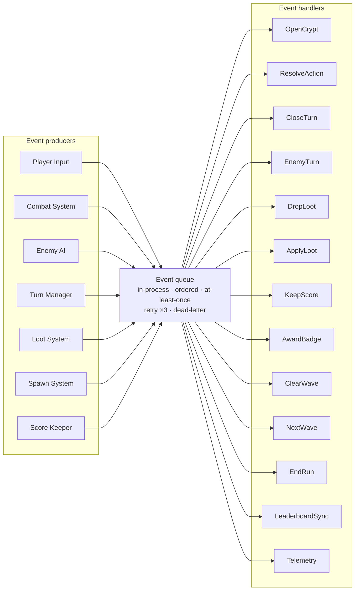
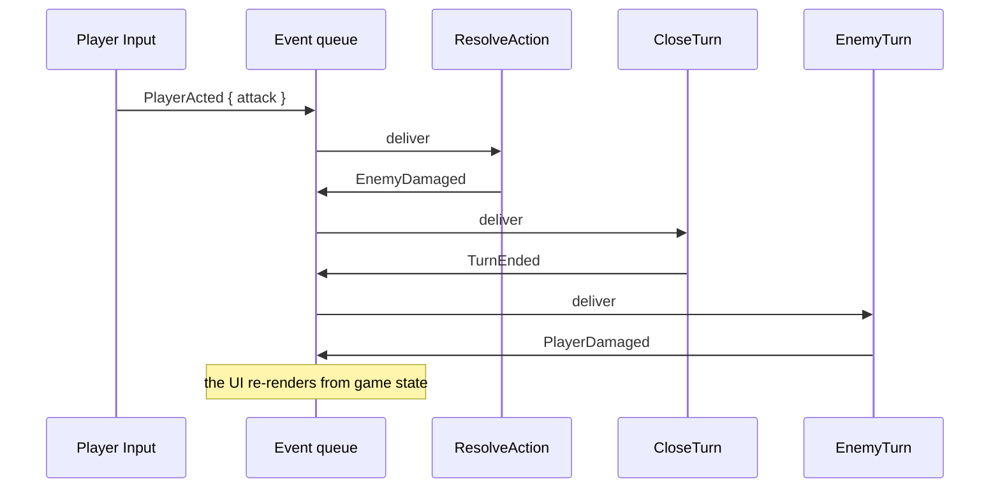

# Architecture

Ember Crypt is a turn-based dungeon crawl built on a **local, in-process event queue**. There is no
`while (gameRunning)` loop and no orchestrator calling systems in order. Input publishes an event,
the queue delivers it, handlers change state and publish the next events.

---

## Overview



---

## The three parts

### 1. Event producers

A producer is any code that calls:

```js
publish(topic, payload, producerName);
```

| Producer | Publishes |
| --- | --- |
| Player Input | `GameStarted`, `PlayerActed` |
| Combat System | `EnemyDamaged`, `EnemyDefeated`, `PlayerBlocked`, `PlayerHealed`, `ActionRejected`, `WaveCleared` |
| Enemy AI | `PlayerDamaged`, `GameOver` |
| Turn Manager | `TurnEnded` |
| Loot System | `LootDropped`, `LootCollected` |
| Spawn System | `EnemySpawned` |
| Score Keeper | `AchievementUnlocked` |
| Event Queue | `DeliveryFailed` (system event) |

Producers never call handlers. The UI publishes `PlayerActed` and then simply renders whatever state
the handlers leave behind.

### 2. Event queue

Implemented in `src/lib/eventBus.js`, no dependencies.

1. **Log** the event.
2. **Fan out** — one delivery per handler subscribed to the topic (or to `"*"`).
3. **Deliver** — run deliveries one at a time, in creation order, 140 ms apart so the flow is visible.
4. **Retry** — a handler that throws is retried up to three attempts with growing backoff.
5. **Dead-letter** — after the last attempt the delivery is marked `dead` and the queue publishes
   `DeliveryFailed`.
6. **Report** — every state change is pushed to the UI, which renders the live queue panel.

Delivery states: `queued → processing → done`, or `processing → retrying → processing`, or
`processing → dead`.

### 3. Event handlers

```js
{
  id: "enemy-turn",
  label: "EnemyTurn",
  topic: "TurnEnded",
  run: (state) => async (event, ctx) => {
    // roll damage, subtract health, then publish the outcome
    ctx.publish("PlayerDamaged", { damage, hpLeft: state.hp }, "Enemy AI");
  },
}
```

Handlers are factories that close over the game state, so each run of the game gets a fresh,
isolated set of handlers — nothing leaks between runs.

| Handler | Subscribes to | Publishes |
| --- | --- | --- |
| OpenCrypt | `GameStarted` | `EnemySpawned` |
| ResolveAction | `PlayerActed` | `EnemyDamaged`, `EnemyDefeated`, `PlayerBlocked`, `PlayerHealed`, `ActionRejected` |
| CloseTurn | `EnemyDamaged`, `PlayerBlocked`, `PlayerHealed`, `ActionRejected` | `TurnEnded` |
| EnemyTurn | `TurnEnded` | `PlayerDamaged`, `GameOver` |
| DropLoot | `EnemyDefeated` | `LootDropped` |
| ApplyLoot | `LootDropped` | `LootCollected` |
| KeepScore | `EnemyDefeated`, `LootCollected`, `WaveCleared` | `AchievementUnlocked` |
| AwardBadge | `AchievementUnlocked` | — |
| ClearWave | `EnemyDefeated` | `WaveCleared` |
| NextWave | `WaveCleared` | `EnemySpawned` |
| EndRun | `GameOver` | — |
| LeaderboardSync | `GameOver` | — (always fails → dead-letter) |
| Telemetry | `DeliveryFailed` | — |

---

## A turn, end to end



Six deliveries, one player click. If the attack kills the enemy the `EnemyDamaged` branch is
replaced by `EnemyDefeated`, which fans out to loot, score and the next wave — the turn loop is not
involved at all.

---

## Design decisions

| Decision | Why |
| --- | --- |
| Local in-process queue | The assignment allows a local queue; it removes infrastructure while keeping real semantics. |
| No central game loop | Game rules live in subscribers, so a new rule is a new handler, not an edit to the input code. |
| Choreography | `NextWave` runs because `WaveCleared` happened, not because someone called it. |
| At-least-once delivery | A delivery is marked done only after the handler resolves, so no hit or drop is lost. |
| Retry with backoff | Transient failures resolve themselves; a failed leaderboard sync never blocks the game. |
| Dead-letter queue | Permanent failures are isolated and surfaced as `DeliveryFailed` instead of looping forever. |
| Events for rejections | `ActionRejected` is an event, so the turn still closes normally and the UI can show the reason. |
| Handler factories | Each run builds handlers bound to a fresh state object, so restarting leaks nothing. |

---

## Extending the game

- **New rule:** add a handler subscribed to an existing topic. Nothing else changes.
- **New step:** publish a new event from a producer or handler, document it in `events.md`.
- **Real broker:** replace `createEventBus` with a Kafka/RabbitMQ/SQS client exposing the same
  `publish` / `subscribe` shape. Producers and handlers stay untouched.

---

## Where the code lives

| File | Role |
| --- | --- |
| `src/lib/eventBus.js` | The queue: publish, fan-out, retry, dead-letter |
| `src/lib/game.js` | Game state, enemy table, every handler, `createGame` |
| `src/lib/catalog.js` | Event catalog rendered on `/events` |
| `src/lib/useGame.js` | React binding between the queue and the UI |
| `src/routes/index.jsx` | The game |
| `src/routes/architecture.jsx` | This document, rendered in the app |
